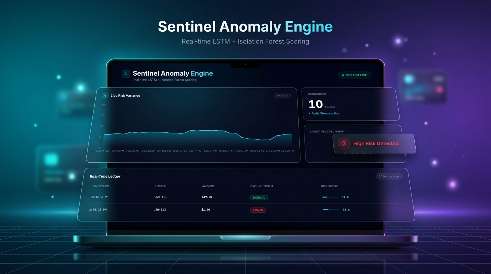
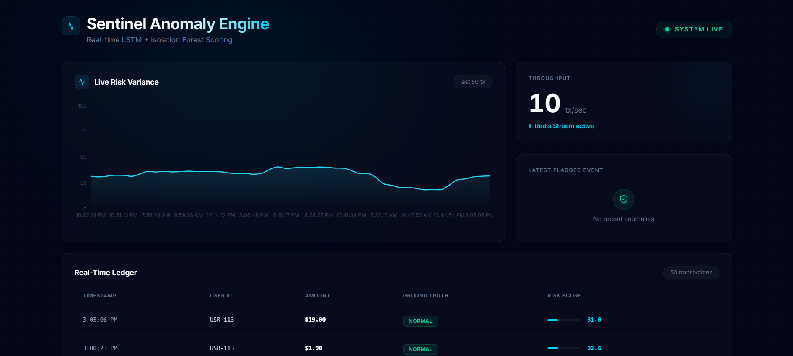

# Sentinel Anomaly Engine

> Real-time credit card fraud detection using an LSTM Autoencoder + Isolation Forest ensemble, streamed live to a React dashboard via Redis and WebSockets.

---

## Overview

This project is an end-to-end, production-style **real-time anomaly detection system** built on the [Kaggle Credit Card Fraud Detection dataset](https://www.kaggle.com/datasets/mlg-ulb/creditcardfraud). It goes beyond offline model evaluation — every transaction is scored live by two ML models, fused into a single risk score, and streamed to a browser dashboard in under a second.

The system is built in four distinct phases:

| Phase | What it does |
|---|---|
| **1 — Feature Engineering** | Enriches raw PCA transaction data with 6 behavioral features |
| **2 — Model Training** | Trains Isolation Forest + LSTM Autoencoder offline |
| **3 — Live Pipeline** | Streams transactions through Redis -> Consumer -> Pub/Sub |
| **4 — UI** | FastAPI WebSocket server feeds a React dashboard in real time |

---

## Architecture

```
┌─────────────────────────────────────────────────────────────────────┐
│                         OFFLINE PHASE                               │
│                                                                     │
│  creditcard.csv                                                     │
│       │                                                             │
│       ▼                                                             │
│  feature_pipeline.py  ──► creditcard_engineered.csv                 │
│       │                         │                                   │
│       ▼                         ▼                                   │
│  train_iso_forest.py    train_lstm.py                               │
│       │                         │                                   │
│       ▼                         ▼                                   │
│  models/iso_forest.pkl   models/lstm_autoencoder.h5                 │
│                          models/lstm_scaler.pkl                     │
│                          models/threshold.txt                       │
└─────────────────────────────────────────────────────────────────────┘

┌─────────────────────────────────────────────────────────────────────┐
│                       REAL-TIME PHASE                               │
│                                                                     │
│  producer.py                                                        │
│    │  Reads engineered CSV row by row @ 10 tx/sec                  │
│    │  Pushes each tx to Redis Stream: txn_stream                    │
│    ▼                                                                │
│  Redis Stream (txn_stream)                                          │
│    │                                                                │
│    ▼                                                                │
│  consumer.py                                                        │
│    │  Loads Isolation Forest + LSTM Autoencoder                     │
│    │  Reads txn_stream, scores each transaction                     │
│    │  Computes ensemble risk (40% IF + 60% LSTM)                    │
│    │  Publishes scored payload to Redis Pub/Sub: scored_txns        │
│    ▼                                                                │
│  Redis Pub/Sub (scored_txns)                                        │
│    │                                                                │
│    ▼                                                                │
│  server.py  (FastAPI + asyncio WebSocket)                           │
│    │  Subscribes to scored_txns                                     │
│    │  Forwards each scored transaction to connected browser         │
│    ▼                                                                │
│  React Dashboard  (localhost:5173)                                  │
│    └─ Live Risk Variance chart                                      │
│    └─ Throughput counter                                            │
│    └─ Latest flagged event alert                                    │
│    └─ Real-Time Ledger with risk score bars                         │
└─────────────────────────────────────────────────────────────────────┘
```

---

## Feature Engineering

**Script:** `feature_pipeline.py`

The Kaggle dataset provides 28 anonymized PCA components (V1–V28) and an `Amount` field. This pipeline synthesizes realistic behavioral context and adds 6 new features:

| Feature | Description |
|---|---|
| `hour_of_day` | Hour extracted from transaction timestamp |
| `time_since_last_txn_mins` | Minutes since user's previous transaction |
| `is_new_merchant` | 1 if this user-merchant pair is new |
| `merchant_country_change` | 1 if country differs from user's last transaction |
| `txn_velocity_1h` | Rolling count of transactions in the past hour |
| `amount_zscore` | Z-score of amount vs. user's expanding historical mean |

These features help models detect **behavioral anomalies** (sudden country changes, transaction bursts, new merchants at odd hours) that the raw PCA components alone cannot capture.

---

## Models

### Isolation Forest — `train_iso_forest.py`

- Unsupervised anomaly detection using 200 decision trees
- Trained on all 35 features (28 PCA + 7 behavioral)
- `contamination=0.02` sets the baseline anomaly rate
- Outputs a continuous anomaly score mapped to a 0–100 risk scale
- Saved to: `models/iso_forest.pkl` (model + scaler bundled)

### LSTM Autoencoder — `train_lstm.py`

- Sequence-based anomaly detection — learns **normal transaction patterns over time**
- Architecture: `LSTM(32) -> RepeatVector(10) -> LSTM(32) -> TimeDistributed(Dense)`
- Trained **only on normal transactions** (Class = 0) to learn the reconstruction of non-fraud sequences
- Anomaly = high reconstruction error (MAE) on unseen sequences
- Threshold set at `mean + 3*sigma` of validation reconstruction errors
- Saved to: `models/lstm_autoencoder.h5`, `models/lstm_scaler.pkl`, `models/threshold.txt`

### Ensemble Scoring — `consumer.py`

At inference time the two model scores are fused:

```
final_risk = (isolation_forest_risk * 0.40) + (lstm_risk * 0.60)
```

The LSTM carries more weight because it captures **sequential behavioral context** (10-transaction sliding window per user) that the stateless Isolation Forest misses. The result is a 0–100 risk score emitted per transaction.

---

## Live Pipeline

### Producer — `producer.py`

Replays the engineered dataset as a live stream:
- Connects to Redis on `localhost:6379`
- Pushes each row to Redis Stream `txn_stream` via `XADD`
- `time.sleep(0.1)` simulates **10 transactions per second**

### Consumer — `consumer.py`

Core scoring engine:
- Reads from `txn_stream` using `XREAD` (blocking, batches of 10)
- Maintains an in-memory `user_history` dict — last 10 transactions per user for LSTM sequences
- Runs Isolation Forest (stateless) + LSTM (stateful per user)
- Publishes scored payload to Redis Pub/Sub channel `scored_txns`:

```json
{
  "user_id": 42,
  "amount": 134.50,
  "risk_score": 78.3,
  "is_fraud": 0,
  "timestamp": "2024-01-01T03:12:44"
}
```

- Prints `[ALERT]` for risk > 70, `[WARNING]` for missed fraud to stdout

### WebSocket Server — `server.py`

Bridge between Redis and the browser:
- **FastAPI** application with async WebSocket endpoint at `/ws`
- Uses `redis.asyncio` to subscribe to `scored_txns` without blocking
- Each scored transaction is forwarded to all connected WebSocket clients within milliseconds

---

## Dashboard



**Stack:** React 19 / Vite 8 / Tailwind CSS v4 / Recharts / Lucide React / Inter font

**Path:** `anomaly-dashboard/`

| Component | Details |
|---|---|
| **Live Risk Variance** | Area chart (Recharts) — plots risk score of last 50 transactions in chronological order with cyan gradient fill |
| **Throughput** | Static counter showing 10 tx/sec with animated Redis Stream status indicator |
| **Latest Flagged Event** | Shows the most recent transaction with risk > 70 — amount, user ID, and a rose-colored alert card |
| **Real-Time Ledger** | Scrolling table of the 10 most recent transactions — timestamp, user ID, amount, ground truth label (NORMAL/FRAUD badge), and a mini progress bar + numeric risk score |

**WebSocket lifecycle:**
```
ws://127.0.0.1:8000/ws -> onmessage -> setTransactions (ring buffer, max 50)
```
State is held in a single `useState` array. Chart data reverses the array on render to produce a left-to-right timeline.

---

## Tech Stack

| Layer | Technology |
|---|---|
| ML — Anomaly Detection | scikit-learn `IsolationForest` |
| ML — Sequential Modeling | TensorFlow / Keras LSTM Autoencoder |
| Data Processing | pandas, NumPy |
| Message Queue | Redis Streams (`XADD` / `XREAD`) |
| Event Bus | Redis Pub/Sub (`PUBLISH` / `SUBSCRIBE`) |
| API / WebSocket | FastAPI + `uvicorn` + `asyncio` |
| Frontend | React 19 + Vite 8 |
| Styling | Tailwind CSS v4 |
| Charts | Recharts |
| Icons | Lucide React |

---

## Project Structure

```
redi-card-fraud-detections/
│
├── creditcard.csv                  # Raw Kaggle dataset (not committed)
├── creditcard_engineered.csv       # Feature-engineered output
│
├── data_prep.py                    # Initial column synthesis (IDs, timestamps)
├── feature_pipeline.py             # Behavioral feature engineering (Phase 1)
├── train_iso_forest.py             # Isolation Forest training (Phase 2a)
├── train_lstm.py                   # LSTM Autoencoder training (Phase 2b)
│
├── producer.py                     # Redis Stream publisher @ 10 tx/sec
├── consumer.py                     # Ensemble scorer -> Redis Pub/Sub
├── server.py                       # FastAPI WebSocket server
│
├── models/
│   ├── iso_forest.pkl              # Isolation Forest + scaler
│   ├── lstm_autoencoder.h5         # LSTM Autoencoder weights
│   ├── lstm_scaler.pkl             # StandardScaler for LSTM input
│   └── threshold.txt               # Reconstruction error threshold
│
├── anomaly-dashboard/              # React frontend
│   ├── src/
│   │   └── App.jsx                 # Main dashboard component
│   └── package.json
│
└── docs/
    ├── banner.png                  # Product hero banner mockup
    └── dashboard.png               # Dashboard screenshot
```

---

## Setup & Running

### Prerequisites

- Python 3.9+
- Node.js 18+
- Redis running on `localhost:6379`

### 1. Install Python dependencies

```bash
pip install pandas numpy scikit-learn tensorflow keras redis fastapi uvicorn joblib
```

### 2. Install frontend dependencies

```bash
cd anomaly-dashboard
npm install
```

### 3. Run the pipeline (5 terminals)

```bash
# Terminal 1 — Feature engineering (run once)
python feature_pipeline.py

# Terminal 2 — Train models (run once)
python train_iso_forest.py
python train_lstm.py

# Terminal 3 — Start the WebSocket server
python server.py

# Terminal 4 — Start the transaction producer
python producer.py

# Terminal 5 — Start the scoring consumer
python consumer.py

# Terminal 6 — Start the React dashboard
cd anomaly-dashboard && npm run dev
```

Open [http://localhost:5173](http://localhost:5173) — transactions will begin flowing within seconds.

---

## How Risk Scores Work

```
Risk Score = 0–100

  0 - 40   Low risk      [Cyan indicator]
 41 - 70   Medium risk   [Cyan indicator]
 71 - 100  HIGH RISK     [Rose indicator + row highlight + alert card]
```

A score above 70 triggers:
- Console `[ALERT]` in the consumer
- Rose-highlighted table row
- "Latest Flagged Event" card update in the dashboard

---

## Dataset

[Kaggle — Credit Card Fraud Detection](https://www.kaggle.com/datasets/mlg-ulb/creditcardfraud)

- 284,807 transactions over 2 days
- 492 fraud cases (0.172% of all transactions)
- 28 PCA-anonymized features (V1–V28) + Amount + Time
- User/merchant IDs and country are synthesized for behavioral feature engineering
